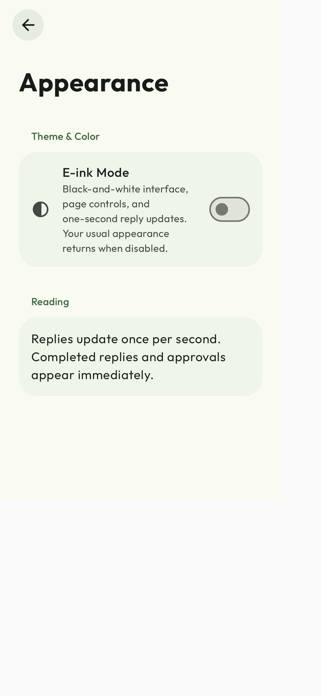
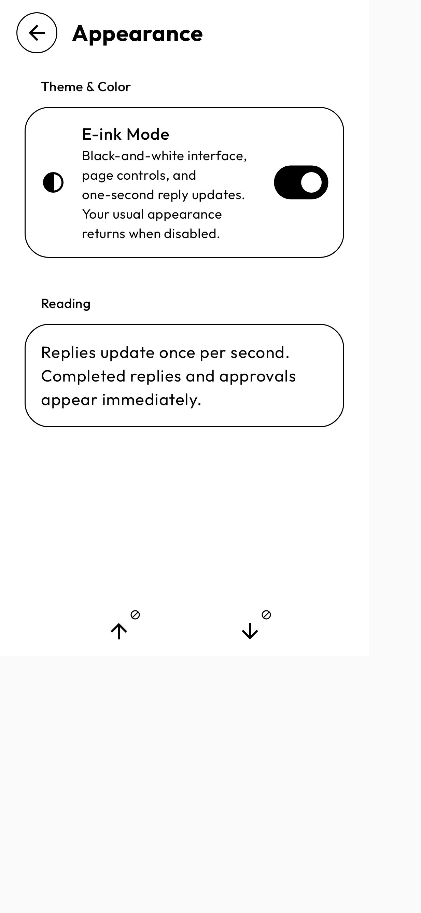
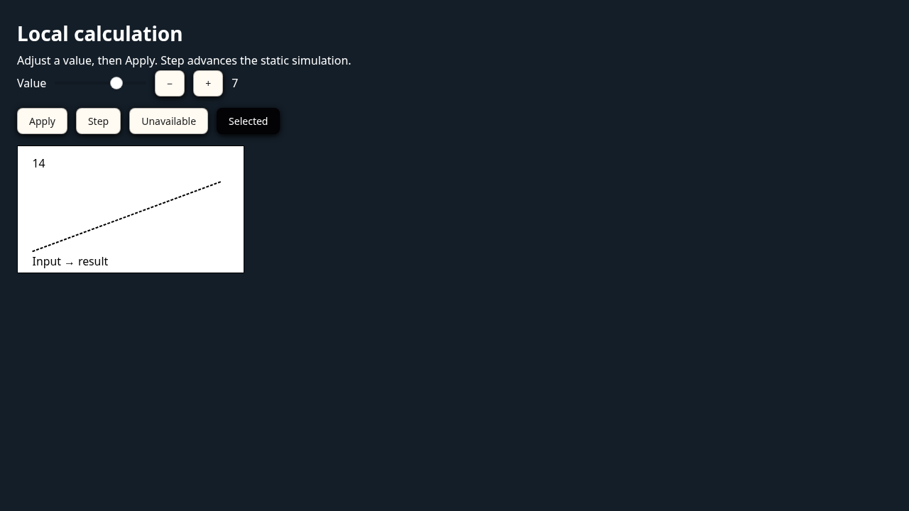
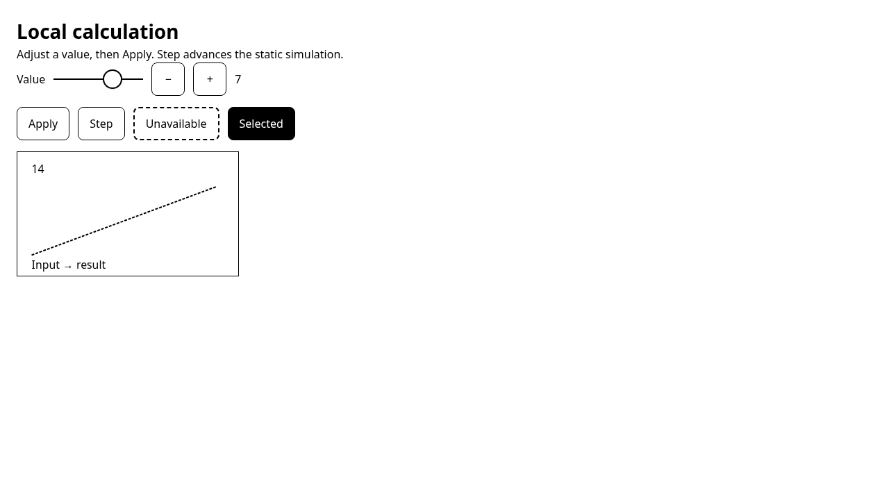

# E-ink validation renders

Generic component/browser fixtures for the optional e-ink contribution to Agora.
Source commit: 183f366f202b065d16b12c56a0af64ee9bdee4e8 (based on interactive answers PR #154).

These are test renders, not complete physical-device screenshots or panel acceptance.
No user conversations, credentials, APKs, preview configuration or device database dumps
are included. The source contribution is on codex/eink-interactive-answers.

## Checks

- Play unit suite: 3,063 tests, zero failures/errors, three skips.
- F-Droid unit suite: 3,080 tests, zero failures/errors, three skips.
- Build-logic: ten tests, zero failures/errors.
- Kotlin source-size gate: passed.
- Both store release variants and separate unofficial ARM64 preview: passed using
  Flatpak Android Studio's Java 21 toolchain. Preview APK signature verified.
- Browser harness: calculator/SVG, slider touch ownership, mode switching without
  reinitialization or value/scroll loss, document/window events once, preserved imagery,
  paging overlap/bounds, sandbox/bridge validation, reopening/offline and live Chart.js.
- PR #154 default tool instructions match the pinned fixture byte-for-byte; only the
  optional 129-word e-ink addendum is appended for newly admitted e-ink requests.

## Renders

| Normal | E-ink |
| --- | --- |
|  |  |
|  |  |

The Step/Apply controls shown are one test fixture, not required generated controls.
The authoring guidance permits manual steps or intermittent automatic progression.
Physical readability, ghosting and redraw comfort still require user assessment.
